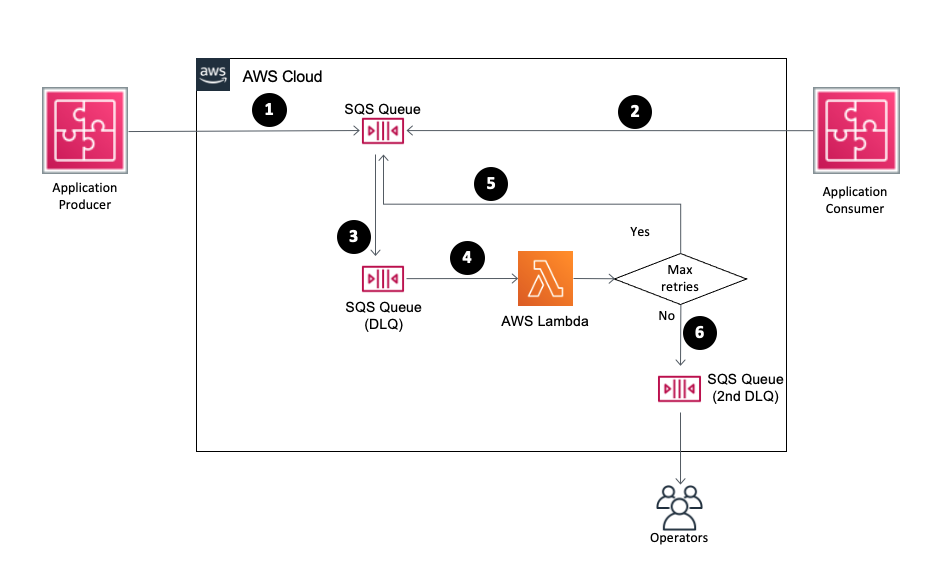

# Architecture of self-healed systems

*(A drop of wisdom in the ocean of madness)*

> **DISCLAIMER**
>
> "Just as no cure has been found for every disease, no single solution exists for all problems. This article should be interpreted in a way that best addresses your specific challenges."

## 1. Introduction

In today’s fast-paced, always-on digital world, system failures and downtime are costly—both in terms of money and reputation. Traditionally, engineers have relied on manual interventions, often requiring immediate responses to unexpected issues through tools like PagerDuty, which has become a common but increasingly exhausting practice across tech teams. But what if systems could automatically detect, diagnose, and correct their issues without human intervention or middle-of-the-night alerts? Enter self-healed systems, an architectural approach that promises to revolutionize how we design and maintain resilient, fault-tolerant software.

For senior software engineers tasked with building scalable systems, understanding how to architect a self-healing system (SHS) isn’t just a nice-to-have—it’s becoming essential. As systems grow more complex, the need for automation that can preemptively respond to failures is critical. In this article, we’ll explore the architecture of self-healed systems, diving into the core components and techniques that make them work, and how you can leverage them to build more reliable software — and, maybe, sleep through a storm\*.


*(\* "Sleep through a storm" is an idiomatic expression that refers to someone remaining calm, undisturbed, or unaffected during chaos, challenges, or difficult situations.)*

## 2. What are Self-Healed Systems (SHS)?

A self-healed system is a system that can automatically detect problems or failures and fix them without needing human intervention. It's designed to monitor itself, identify issues, and take corrective actions to restore normal operation [1].

The goal of self-healed systems is to minimize downtime and ensure continuous performance, often found in software, networks, and cloud environments.

We do have a lot of real-life examples of such systems, for instance **Kubernetes** - is a widely used container orchestration platform that supports self-healing capabilities. It automatically restarts failed containers, replaces them, reschedules tasks, and kills containers that don't respond to health checks, ensuring high availability in cloud-native applications [2].

Another example can be **Netflix Chaos Monkey**. Netflix developed a tool called **Chaos Monkey** as part of its broader "Simian Army" suite, which randomly terminates virtual machines and containers in production to ensure that their systems can automatically detect failures and recover without human intervention [3].

**IBM's Autonomic Computing Initiative**: IBM has been developing self-healing technologies under its **autonomic computing** initiative, where systems can automatically configure, optimize, and heal themselves. For example, IBM's **Tivoli Monitoring** software helps manage performance and automatically fixes configuration issues to maintain health.

These real-world implementations showcase how self-healing systems are being used to ensure resilience, minimize downtime, and reduce the need for manual interventions in modern infrastructure and applications. But question is how to build one by your own, and I am here to help you with that.


**References**

1. Shaan Ray, “What Is A Self Healing System?”, URL: <https://hackernoon.com/self-healing-system-concept-explained-ot6r3w8w>
2. Why you need Kubernetes and what it can do. URL: <https://kubernetes.io/docs/concepts/overview/#why-you-need-kubernetes-and-what-can-it-do>
3. Netflix Chaos Monkey GitHub Repository: URL: <https://github.com/Netflix/chaosmonkey>

## 3. Key Architectural Concepts

To heal, you first need to acknowledge that you're not okay. The same principle applies to computer systems: they must be capable of self-analysis and state monitoring. Essentially, the ability to self-analyze is a fundamental requirement for implementing any self-healing system.

### 3.1. Self-analysis and state monitoring

The concept of "Health Check" and "Heartbeat" is well-established, with many frameworks offering default implementations, such as the health checks in ASP.NET Core [1]. By integrating self-verification mechanisms, you ensure that your system is correctly configured, has the necessary permissions and access, and can execute its functionality without errors.

Based on specific requirements, it is advisable to implement both simple and extended health check methods. The simple, fast check can be run immediately before the main functionality, ensuring basic operational readiness. In contrast, the extended, more time-consuming check thoroughly assesses the system's state, including all connections and dependencies.

For example, consider an AWS Lambda function that performs calculations using data from an external system. This function updates a record in a database and subsequently publishes an event to a message broker. In this case, both a quick pre-execution check and a deeper, more comprehensive verification of all dependencies would be essential to ensure seamless operation.

All my functions have some implementation of configuration check like this.

```typescript
function checkConfiguration(
  requiredVariableNames: string[],
  shouldThrow: boolean = true
): boolean {
  const missingVars: string[] = []
  for (const variable of requiredVariableNames) {
    if (process.env[variable] == null) {
      missingVars.push(variable)
    }
  }
  if (missingVars.length > 0) {
    if (shouldThrow) {
      throw new Error(
        `Missing required environment variables: [${missingVars.join(', ')}]`
      )
    }
    return false
  }
  return true
}
```

*Example of a check configuration function. (TypeScript)*

It should be executed inside error handler before calling main functionality. You will not believe how many times it disclosed missing configuration or broken terraform scripts on early steps.

**References**

1. “Health checks in ASP.NET Core”, URL: <https://learn.microsoft.com/en-us/aspnet/core/host-and-deploy/health-checks?view=aspnetcore-8.0>

A more extended version would require designing your system so that each module implements its own self-validation functionality. Alternatively, you could create a list of component check functions, which can then be passed as parameters to the main health check function, like this one.

```typescript
function healthCheck(functions: HealthCheckFunction[]): {
  healthState: { [key: string]: string }
  state: string
} {
  const healthState: { [key: string]: string } = {}
  let overallHealthy = true
  functions.forEach((func, index) => {
    const isHealthy = func() // Execute the health check function
    const funcName = func.name || `Function[${index + 1}]` // Use the function name or fallback to a default name
    healthState[funcName] = isHealthy ? 'healthy' : 'unhealthy'
    if (!isHealthy) {
      overallHealthy = false
    }
  })
  return {
    healthState,
    state: overallHealthy ? 'healthy' : 'unhealthy',
  }
}
```

*Example of a check configuration function. (TypeScript)*

The execution of these methods can be made available through an HTTP API call. However, ensure that the API is not publicly accessible to prevent the disclosure of sensitive information and vulnerabilities.

### 3.2. Logging and Tracing

Ability to analyze self-state won’t worth much without appropriate logging as well as logging won’t bring much value without appropriate traceability. This will be necessary for better understanding of execution process and issue detection. Let’s say your system start failing, appearance of `NullReferenceException` in the logs won’t worth much if you can’t track execution process or logs mixed across multiple execution processes [1]. Therefore, including trace data is essential. Elements like request ID, user ID, and process name should be included as they can provide valuable insights. However, be mindful of PII (Personally Identifiable Information) and sensitive data—these should never be logged.

Including a source code reference in the log can be valuable, as it identifies the exact file and method where the log originated. This detail can also assist automated systems in taking corrective actions to resolve issues. Use appropriate Log Levels for different cases, it will help to distinguish severity of a problems, especially in a process with retries.

Once tracing will be configured you will be able to track executing through all systems, processes, functions whatever just searching over the logs.

```json
{
  "trace_id": "abc123-xyz789",
  "timestamp": "2024-11-20T14:30:45.123Z",
  "service": "user-authentication-service",
  "log_level": "INFO",
  "event": {
    "name": "UserLogin",
    "status": "success",
    "message": "User successfully logged in."
  },
  "context": {
    "user_id": "user456",
    "session_id": "sess789",
    "ip_address": "192.168.1.1"
  },
  "on_demand_triggers": {
    "error": false,
    "performance_issue": false,
    "custom_condition": "n/a"
  }
}
```

*Example of a log trace structure. (JSON)*

#### 3.2.1. Log on demand

Large-scale systems often face challenges with overloaded log storage, which incurs significant costs for companies in terms of storage, processing, and management. This inspired the concept of "log on demand"—a straightforward approach where logs are only written to storage when needed.

Under normal circumstances, such as when operations execute successfully, routine logs like function start times or request completions are unnecessary. These details become valuable primarily for troubleshooting or analysis during failures or anomalies.

This method differs from traditional log-level filtering in that it doesn't involve filtering logs after they are generated. Instead, unnecessary logs are neither produced nor stored, resulting in more efficient system performance and cost savings.

While the "log on demand" concept isn't widely implemented as a core feature in most logging libraries, there are ways to achieve this functionality using existing tools and techniques. You can implement a "log on demand" mechanism using custom logic:

- Create a middleware or utility class to wrap log invocations.
- Maintain a flag or state to track whether detailed logs are necessary.
- Write logs conditionally based on runtime states, such as detecting errors or specific event triggers.

**References**

1. “Logs vs Metrics vs Traces”, URL: <https://microsoft.github.io/code-with-engineering-playbook/observability/log-vs-metric-vs-trace/>

### 3.3. Retries with exponential backoff

Failures in processes and operations frequently stem from resource unavailability, particularly in distributed systems, microservices, and serverless architectures. Issues like losing a database connection during a dackpack release or encountering cluster downtime due to regional maintenance are common. How often have I found errors in the logs caused by ElasticSearch index unavailability—whether from reindexing, high load, or other factors. Should all these minor issues trigger critical errors and flood PagerDuty with alerts? I don’t think so. Implementing a simple retry logic could save you hours of investigation and post-incident discussions.

```typescript
export const executeWithRetry = async (
  func: () => Promise<any>,
  retries: number = 3,
  baseDelayMs: number = 1000,
  maxDelayMs: number = 10000
): Promise<any> => {
  let attempt = 1
  let currentRetries = retries
  let exception: Error | null = null
  do {
    try {
      return await func()
    } catch (ex) {
      exception = ex as Error
      if (ex instanceof NonRetryableException) {
        throw ex
      }
    }
    if (--currentRetries > 0) {
      const delay = Math.min(baseDelayMs * 2 ** (attempt - 1), maxDelayMs)
      await new Promise((resolve) => setTimeout(resolve, delay))
      attempt++
    }
  } while (currentRetries > 0)
  if (exception != null) {
    throw exception
  }
}
```

*Example of an exponential retry function. (TypeScript)*

This is my variant of an exponential retry function, you can find any appropriate implementation in existing libraries or create your own.

Be mindful of retries count and base delay time to be sure that the time your code will be awaiting won't cuz function timeout.

**References**

1. “Implement retries with exponential backoff”, URL: <https://learn.microsoft.com/en-us/dotnet/architecture/microservices/implement-resilient-applications/implement-retries-exponential-backoff>

### 3.4. Dead-letter queue processing

Asynchronous execution is a fundamental concept in distributed system architecture. Rather than managing connectivity between subsystems, you only need to ensure accessibility between the message broker and the subscriber. An event is published, and all subscribers act accordingly. However, as with any system, issues can arise: unprocessable, broken, or "poisoned" messages may occur and ultimately end up in the dead-letter queue (DLQ) [1]. And is that the end of the story? Not quite. There are various approaches to handling these cases. Some may choose to ignore them and let the messages sit indefinitely, while others may trigger compensation events to reverse any potential negative effects.

Maybe it’s the echoes of past mishaps that compel me to grasp for control, striving to tame the chaos woven into this imperfect world of software development. A relentless dance between order and disorder, where each line of code is an attempt to bring harmony to the inevitable turbulence. Long story short I prefer to process messages from DLQ.

Distributed processes require a level of supervision, often managed by Sagas [2], though they aren’t always applicable. For instance, in loosely coupled or external subsystems, you may have no access, making it impossible to directly control their behavior without relying on compensation events.

This is how AWS recommend dealing with queues:

1. The producer application sends a message to an SQS queue
2. The consumer application fails to process the message in the same SQS queue
3. The message is moved from the main SQS queue to the default dead-letter queue as per the component settings.
4. A Lambda function is configured with the SQS main dead-letter queue as an event source. It receives and sends back the message to the original queue adding a message timer.
5. The message timer is defined by the exponential backoff and jitter algorithm.
6. You can limit the number of retries. If the message exceeds this limit, the message is moved to a second DLQ where an operator processes it manually.



**References**

1. “What is a Dead-Letter Queue (DLQ)?”, URL: <https://aws.amazon.com/what-is/dead-letter-queue/>
2. “Saga distributed transactions pattern”, URL: <https://learn.microsoft.com/en-us/azure/architecture/reference-architectures/saga/saga>

## 4. Automated AI Assistance

AI, particularly Large Language Models (LLMs), offers a transformative approach to incident management in software development. An increasing number of companies are incorporating AIs into their incident management strategies, with Meta being a notable example [1]. Integrating AI into incident management can modernize workflows, particularly by enabling automated generation of draft pull requests. While the final responsibility rests with developers to validate and implement fixes, AI serves as an invaluable tool for enhancing efficiency and reducing downtime.

### 4.1. Automated Incident Analysis

- **Root Cause Identification**: AI can analyze logs, metrics, and other data sources to identify the root causes of incidents with considerable accuracy.
- **Pattern Recognition**: By leveraging machine learning models, AI detects recurring issues and trends, helping teams understand the underlying problems.

### 4.2. Draft Pull Request Generation

- **Code Change Recommendations**: AI tools can suggest or generate draft pull requests that include potential fixes for the identified issues. These drafts are created based on historical resolution patterns and code context.
- **Developer Review Ready**: These drafts act as a starting point, allowing developers to focus on reviewing and refining the fix rather than starting from scratch.
- **Speed and Efficiency**: This approach reduces the time taken to respond to incidents and accelerates the deployment of resolutions.

### 4.3. Enhancing Developer Collaboration

- **Actionable Suggestions**: Instead of vague alerts, AI provides developers with actionable insights and recommendations.
- **Integrated Workflows**: Tools can integrate into CI/CD pipelines, linking incident detection to the code review process seamlessly.

### 4.4. Benefits

- **Faster MTTR**: Mean time to resolution is significantly reduced as AI assists both in problem identification and resolution drafting.
- **Developer Productivity**: Automating initial steps frees up developers to focus on higher-value tasks like optimization and innovation.
- **Improved Accuracy**: Machine learning ensures recommendations are based on well-analyzed data, minimizing human error.

**References**

1. “How Meta Uses LLMs to Improve Incident Response (and how you can too)”, url: <https://www.tryparity.com/blog/how-meta-uses-llms-to-improve-incident-response>
