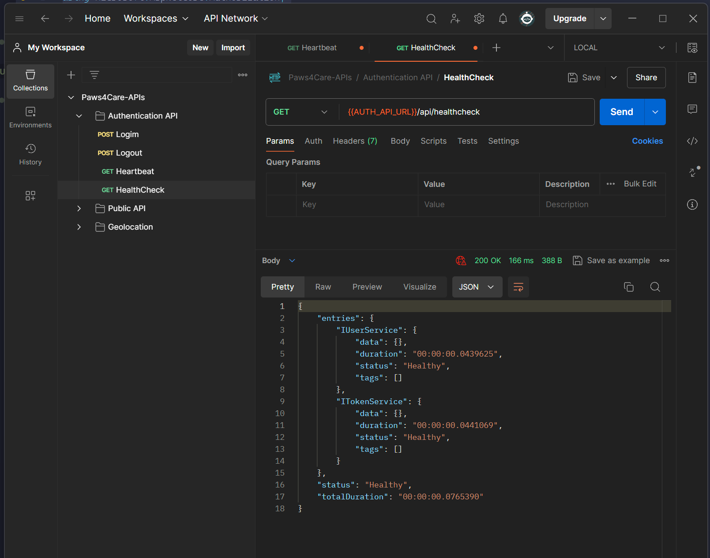

# Embedded Health Checks in Distributed Systems

> "Happiness is when you appear to be and actually are the same."

## 1. Introduction

As part of my work as a developer, I collaborated with a finance company to ensure their systems align with the latest architectural standards. A key focus was migrating from their custom health check implementation to the Microsoft standard approach [1]. I conducted a review of the internal mechanisms and libraries developed by some of their top engineers. At the time of creation, their solution was impressive and innovative. However, over time, the cost of support, maintenance, scalability, and usability began to outweigh its initial benefits.


What was most disappointing, however, was that the health check implementation was largely disconnected from the actual system behavior it was intended to verify. In many cases, HTTP clients, services, and database connections were duplicated, and sometimes even used different approaches or credentials than the production code. As a result, health checks often provide a false sense of reliability. Developers could implement one concept but end up verifying something entirely different.

I did a quick survey of available articles on health check usage and noticed a common issue across most of them. Health checks typically validate whatever is explicitly configured in them — but not necessarily what is actually used in the application code. This disconnect can lead to blind spots, where the system appears healthy on the surface, while critical parts of the application might be failing silently.

This is probably the main reason I decided to write this article - to share my perspective on how health checks should be implemented and used effectively in distributed systems.

**References**

1. “Microsoft.Extensions.Diagnostics.HealthChecks” URL: <https://learn.microsoft.com/pl-pl/dotnet/api/microsoft.extensions.diagnostics.healthchecks?view=net-9.0-pp&viewFallbackFrom=net-8.0>

## 2. What are embedded health checks?

Embedded health checks are built-in mechanisms within a software application that monitor and report on its internal state and dependencies (like databases, APIs, or message brokers). They help ensure the system is running correctly and can respond appropriately to failures, often used in conjunction with monitoring tools or orchestrators like Kubernetes. There are a lot of libraries and tools already created for different languages, Microsoft.AspNetCore.Diagnostics.HealthChecks, terminus for nodejs [1], Spring Boot Actuator, Micronaut Health etc [2].

For web services usually serves http method `GET: api/healthcheck` and response from it should be with status code `200` for healthy state and `503 Service Unavailable` when something went wrong.

```http
HTTP/1.1 503 Service Unavailable
Content-Type: application/json
Cache-Control: no-store
Date: Sat, 20 Apr 2025 13:15:00 GMT

{
  "status": "Unhealthy",
  "duration": "00:00:01.732",
  "checks": [
    {
      "name": "self",
      "status": "Healthy",
      "description": "Application is running"
    },
    {
      "name": "sql-database",
      "status": "Healthy",
      "description": "Database connection is active"
    },
    {
      "name": "redis-cache",
      "status": "Unhealthy",
      "description": "Timeout connecting to Redis",
      "data": {
        "duration": "5s",
        "error": "Connection timeout"
      }
    },
    {
      "name": "external-payment-api",
      "status": "Healthy",
      "description": "External API responded within acceptable time"
    }
  ]
}
```

*Example of a health check response.*

**References**

1. “Terminus”, URL: <https://github.com/godaddy/terminus>
2. “Building a RESTful Web Service with Spring Boot Actuator” URL: <https://spring.io/guides/gs/actuator-service>

## 3. How is it recommended to be configured?

Based on real-world experience, I’ll provide an example in C#, but for majority of languages and systems they are very similar, so it will be actual for everyone.

We are installing a library (in our case `Microsoft.Extensions.Diagnostics.HealthChecks`) to our project. Then configuring it in `Program.cs` or `Startup.cs` depends on implementation.

```csharp
builder.Services.AddHealthChecks()
    .AddSqlServer("YourConnectionStringHere", name: "sql-database")
    .AddRedis("localhost:6379", name: "redis-cache")
    .AddCheck<ExternalApiHealthCheck>("external-payment-api");
```

*Example of a health check configuration.*

Then configuring the http end point, usually like this:

```csharp
app.MapHealthChecks("/health", new HealthCheckOptions
{
    ResponseWriter = async (context, report) =>
    {
        context.Response.ContentType = "application/json";
        var result = new
        {
            status = report.Status.ToString(),
            checks = report.Entries.Select(entry => new
            {
                name = entry.Key,
                status = entry.Value.Status.ToString(),
                description = entry.Value.Description,
                data = entry.Value.Data,
                exception = entry.Value.Exception?.Message
            }),
            duration = report.TotalDuration.ToString()
        };
        await context.Response.WriteAsync(JsonSerializer.Serialize(result,
            new JsonSerializerOptions
            {
                WriteIndented = true
            }));
    }
});
```

And this is how we capture ourselves into a trap, coz configuration of health check and approximated implementation of DB Repository or service can use different assets. Also, the Redis service used in config can be different, even if we are using the same endpoint and port where there is a warranty that configuration will be the same?

## 4. How would I recommend implementing a truly Embedded Health check?

Start with common interface `IHealthCheck` with method for health verification. In dot net it already presents and looks like this:

```csharp
using System.Threading;
using System.Threading.Tasks;

namespace Microsoft.Extensions.Diagnostics.HealthChecks;

public interface IHealthCheck
{
    Task<HealthCheckResult> CheckHealthAsync(
        HealthCheckContext context,
        CancellationToken cancellationToken = default);
}
```

Add this interface as a base interface for implementation to all your connectors, (Interfaces for db, api, services etc).

```csharp
public interface IUserService : IHealthCheck
{
    Task<User?> Find(string id, CancellationToken ct);
    Task<User?> Find(string username, string password, CancellationToken ct);
}
```

This will ensure that **`CheckHealthAsync`** method will be implemented and will be using configured DBContext providers whatever is used in the class.

```csharp
internal class UserService : IUserService
{
    public async Task<HealthCheckResult> CheckHealthAsync(
        HealthCheckContext context,
        CancellationToken ct = new())
    {
        try
        {
            var canConnect = await DbContext.Database.CanConnectAsync(ct);
            return canConnect
                ? HealthCheckResult.Healthy()
                : HealthCheckResult.Unhealthy();
        }
        catch // This is just an example — do not swallow errors; log them instead.
        {
            return HealthCheckResult.Unhealthy();
        }
    }
}
```

And now, during the registration of services you can along with adding dependencies add health verifications

```csharp
using Microsoft.Extensions.DependencyInjection;

namespace Authentication.Services
{
    public static class ServiceCollectionExtensions
    {
        public static IServiceCollection AddApplicationServices(
            this IServiceCollection services)
        {
            var healthCheckBuilder = services.AddHealthChecks();

            services.AddScoped<IUserService, UserService>();
            healthCheckBuilder.AddCheck<IUserService>(nameof(IUserService));

            services.AddScoped<ITokenService, TokenService>();
            healthCheckBuilder.AddCheck<ITokenService>(nameof(ITokenService));

            return services;
        }
    }
}
```

In addition, it is better to have a dedicated controller class for processing results you will be able to control access policies etc.

```csharp
using Microsoft.AspNetCore.Authorization;
using Microsoft.AspNetCore.Mvc;
using Microsoft.Extensions.Diagnostics.HealthChecks;

namespace P4C.Authentication.API.Controllers
{
    [Route("api/[controller]")]
    public class HealthCheckController : BaseController
    {
        private readonly HealthCheckService _healthCheckService;

        public HealthCheckController(HealthCheckService healthCheckService)
        {
            _healthCheckService = healthCheckService;
        }

        [HttpGet]
        [AllowAnonymous]
        public async Task<IActionResult> Get(CancellationToken ct)
        {
            var result = await _healthCheckService.CheckHealthAsync(ct);
            return new ObjectResult(result)
            {
                StatusCode = result.Status == HealthStatus.Unhealthy ? 503 : 200
            };
        }
    }
}
```

From a visibility point of view, this result is much more informative and concrete. We can now rely on validation, as it checks the DI container and the accessibility of internal systems.



## 5. Summary

In this article, I’ve outlined the shortcomings of traditional health check implementations and introduced a more robust approach - embedded health checks that directly use and validate the same services and dependencies as the application logic itself. By aligning health monitoring with actual runtime behavior, we can achieve more reliable and meaningful observability in distributed systems.
