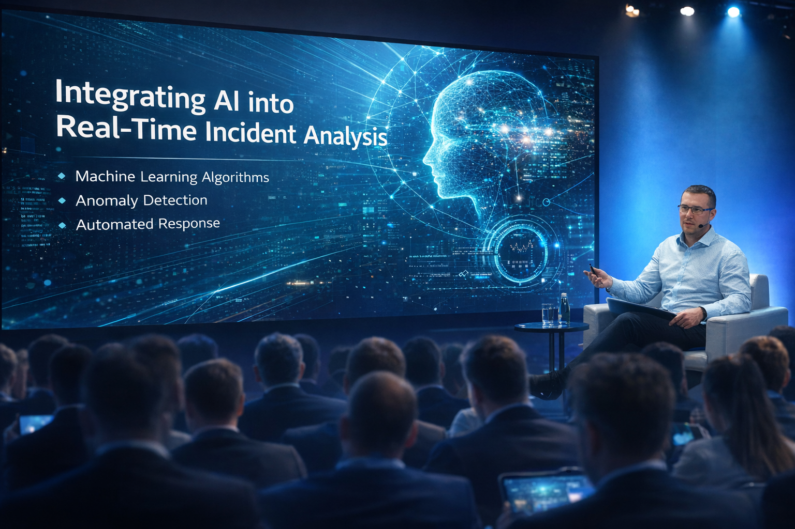
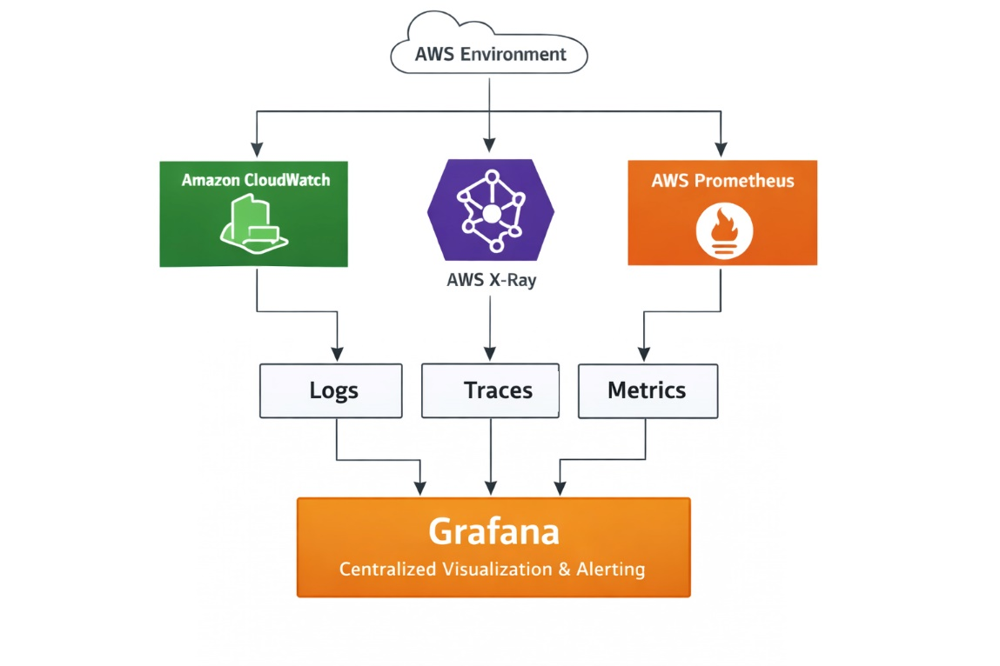

# Integrating AI into Real-Time Incident Analysis



> "AI is not a replacement for engineers - it is a toolkit."

## Introduction

A significant part of software engineering involves real-time incident management and support. Anyone who has been woken up in the middle of the night by a P3 incident knows exactly what I’m talking about. Personally, it’s extremely difficult to provide meaningful data analysis from logs and graphs after such a rude awakening - and doing it quickly is even harder. Fortunately, I work in an environment where quality is a top priority in software development. My team - like the entire company - builds exceptionally robust products. As a result, most of our incidents (around 87%) are related to infrastructure or connection glitches. These issues are usually self-healing or require minimal intervention, such as rerunning a pipeline or republishing events from dead-letter or poison queues. But not every project is as lucky as mine. Many engineers still face messier, more persistent problems.

According to the **SolarWinds 2025 State of ITSM Report** and the **IBM 2025 Cost of a Data Breach Report**, the average time to resolve incidents remains alarmingly high. For standard IT service incidents, the global average resolution time is **32.46** hours. In the case of cybersecurity incidents, the average "breach lifecycle" is **241 days** - with **181 days** spent identifying the threat and 60 days to contain it. Organizations that detect breaches internally typically resolve them in about 172 days. However, if the notification comes from the attacker - for example, through a ransom note - the average resolution time jumps to **245 days** [1][2].

Generative AI has reduced this to approximately 22.55 hours. For more complex cybersecurity breaches, the total lifecycle to identify and contain a threat is now 241 days, with the identification phase taking roughly 181 days and the containment phase averaging **60 days** [2][3].

So, the problem is clear - now it’s time to talk about solutions. I’ve built one that works, at least in my world. Let’s see how it holds up in yours.

*[See the source list at the end for supporting evidence.]*

## Empowering Engineers with AI-Driven Investigation Tools

A commonly used toolset for monitoring is Prometheus and Grafana - often referred to as the "gold standard" for cloud-native observability. Prometheus handles data collection (metrics and state), while Grafana provides visualization and alerting. Together, they work across a wide range of cloud environments, not limited to a single provider. In many setups, they serve as an additional observability layer on top of native tools like Amazon CloudWatch or Azure Monitor. These native tools are typically favored by teams deeply integrated into a specific cloud ecosystem, offering seamless, out-of-the-box monitoring.

I tested my solution using a combination of Grafana and AWS services. In this setup, Grafana monitors the state of an AWS application by serving as a centralized visualization and alerting layer. It connects to various AWS data sources, rather than probing the application directly. Typically, Grafana queries data collected by AWS services such as CloudWatch, X-Ray, or Prometheus.



To monitor an AWS application effectively, Grafana leverages three key data sources: metrics, logs, and traces. Based on configured rules, Grafana can trigger various actions - such as sending events or executing webhooks to notify services like PagerDuty. This is where AI enters the picture.

We can introduce an additional layer between Grafana and PagerDuty: a lightweight application (such as an AWS Lambda or Azure Function) that intercepts the webhook from Grafana. Within this service, we integrate an AI agent (e.g., GitHub Copilot or a custom model) that uses AWS APIs to fetch relevant logs and metrics. The agent then performs an initial analysis of the incident data before escalation.

This approach is often referred to as "AIOps Enrichment" or "Event-Driven Incident Analysis." By inserting an enrichment layer between your monitoring (Grafana) and alerting (PagerDuty), you transform a basic "Service X is down" alert into a meaningful report like: "Service X is down due to a spike in 500 errors from the Checkout API - here are the top five relevant error logs." [4]

### Configure the "Enrichment" Webhook

To enable AI-driven enrichment, the first step is to configure Grafana to route alerts to your enrichment service rather than directly to PagerDuty. This is done by setting up a webhook as a contact point in Grafana. Navigate to **Alerting > Contact Points** and click **+ Add contact point**. Give it a name, such as “Incident-Enrichment-Lambda,” and select **Webhook** as the integration type. In the URL field, enter your Lambda function’s endpoint - either the direct URL or an API Gateway address. Set the HTTP method to `POST`. If your Lambda is secured with an API key, include it in the HTTP headers (e.g., using the `x-api-key` header). Once saved, this configuration will ensure that incident alerts are first sent through your AI enrichment layer before reaching downstream tools like PagerDuty. [5]

### Define the Alert Rule (The Trigger)

Next, define the alert rule that will trigger the enrichment process. This step tells Grafana what “unhealthy” means for your application. Go to **Alerting > Alert rules** and click **+ Create alert rule**. Start by defining your query, for example, selecting the CloudWatch data source and choosing a metric such as `CPUUtilization` from the `AWS/EC2` namespace. Then, set your condition, for instance, “IS ABOVE 80” to indicate high CPU usage. Under **Annotations**, add a custom field like `service_name` or `app_id`. This annotation is crucial, as your Lambda function will use it to identify which logs to retrieve from AWS. Finally, under **Notifications**, link this rule to the previously created Incident-Enrichment-Lambda contact point. This ensures that when the alert is triggered, the webhook fires to your enrichment layer instead of going straight to PagerDuty.

### Set Up the Notification Policy

To complete the integration, configure a notification policy in Grafana to ensure alerts are correctly routed to your enrichment layer. Go to **Alerting > Notification policies** and either create a new policy or edit the default one. Set the contact point to your webhook - the Lambda function you configured earlier. To optimize how alerts are processed, configure grouping rules. It’s often best to group alerts by alert name or instance, which allows your AI agent to receive a single batch of related errors, rather than multiple fragmented webhook calls for what is essentially the same incident. This approach improves context and reduces redundant processing.

> **🧠 Pro Tip:**
>
> You can use Grafana’s template variables like `{{ .Labels.alertname }}` or `{{ .StartsAt }}` inside annotations to populate them dynamically based on the actual alert context. [5]

### Configuration Checklist for the Lambda

When Grafana sends the webhook, it sends a JSON object. For your AI agent to work, ensure your Grafana alert includes these three things:

- **`starts_at`**: Lets the AI pull logs and metrics *starting from the actual incident time*, not just now-ish. Because context matters.
- **`resource_id` / `cluster`**: Gives your AI something to *query*, so it's not guessing in the void like a haunted log gremlin.
- **`source_url`**: Adds traceability and visibility by linking back to the exact dashboard/panel in Grafana. PagerDuty can include this in the incident message, giving humans one-click access to actual data instead of starting a Slack witch hunt.

When you create or edit an alert rule in Grafana (via **Alerting > Alert Rules**), you can define custom fields in the **Annotations** section. These annotations will be included in the webhook payload and are exactly where you want to stick your AI-friendly metadata.

```json
{
  "receiver": "Incident-Enrichment-Lambda",
  "status": "firing",
  "orgId": 1,
  "alerts": [
    {
      "labels": {
        "alert_name": "HighCPUUtilization",
        "instance": "i-1234567890abcdef0",
        "severity": "critical",
        "resource_id": "i-1234567890abcdef0",
        "cluster": "prod-api-cluster"
      },
      "annotations": {
        "summary": "CPU usage is above 80%",
        "description": "High CPU usage for 5 minutes.",
        "service_name": "checkout-api",
        "starts_at": "2025-12-20T10:15:00Z",
        "source_url": "https://grafana.example.com/d/abc123/checkout-dashboard?viewPanel=5"
      },
      "starts_at": "2025-12-20T10:15:00Z",
      "ends_at": "0001-01-01T00:00:00Z",
      "generator_url": "https://grafana.example.com/alerting/rules/1/view"
    }
  ],
  "external_url": "https://grafana.example.com",
  "title": "[FIRING:1] HighCPUUtilization",
  "message": "CPU usage is above 80%"
}
```

## Conclusion

As modern systems continue to grow in complexity, relying solely on human intervention for incident response is neither scalable nor sustainable. Integrating AI into the incident management pipeline introduces a critical layer of speed, consistency, and contextual analysis. By introducing an enrichment layer between Grafana and PagerDuty, organizations can move beyond basic alerting toward actionable insights shifting from “something is broken” to “this is what’s broken, why it happened, and where to begin.”

This approach is not intended to replace engineers, but to empower them. AI functions as a tireless first responder, rapidly analyzing logs and metrics to surface relevant data within moments. The result is improved resolution times, reduced operational stress, and more efficient incident triage. It's not a replacement for human expertise it's an evolution in how that expertise is applied.

## Sources

**[1]** [**SolarWinds 2025 State of ITSM Report**](https://www.solarwinds.com/campaign/state-of-itsm): Provides benchmarks for IT service management based on 60,000+ anonymized incident records.

**[2]** [**IBM Cost of a Data Breach Report 2025**](https://www.ibm.com/reports/data-breach): The primary source for cybersecurity metrics including identify and containment times.

**[3]** [**ITSM.tools Summary**](https://itsm.tools/2025-state-of-itsm-report/): Detailed analysis of the resolution gap and global averages from the SolarWinds data.

**[4] Core Monitoring: Grafana & AWS Integration**

These links cover how Grafana pulls initial data from your AWS environment.

- [**Grafana CloudWatch Data Source Official Docs**](https://grafana.com/docs/grafana/latest/datasources/aws-cloudwatch/): Detailed guide on configuring metrics and log queries for AWS.
- [**Amazon Managed Grafana User Guide**](https://docs.aws.amazon.com/grafana/latest/userguide/what-is-Amazon-Managed-Service-Grafana.html): AWS-specific documentation if you prefer the managed service over self-hosting.
- [**CloudWatch Metric Streams**](https://docs.aws.amazon.com/AmazonCloudWatch/latest/monitoring/CloudWatch-Metric-Streams.html): Reference for setting up high-speed "push" metrics to Grafana via Kinesis Data Firehose.

**[5] The Webhook Layer: Grafana to Lambda**

This is the documentation for the "trigger" that starts your enrichment process.

- [**Grafana Webhook Notifier Configuration**](https://grafana.com/docs/grafana/latest/alerting/configure-notifications/manage-contact-points/integrations/webhook-notifier/): Explains the JSON payload structure Grafana sends to your endpoint.
- [**AWS Lambda Function URLs**](https://docs.aws.amazon.com/lambda/latest/dg/urls-configuration.html): A simple way to give your Lambda a public HTTPS endpoint for Grafana to hit without needing an API Gateway.

**[6] The AI Agent: Amazon Bedrock**

Since you are in AWS, using Amazon Bedrock is the most secure and native way to integrate LLMs (like Claude or Llama) for incident analysis.

- [**Amazon Bedrock Python SDK (Boto3) Examples**](https://docs.aws.amazon.com/bedrock/latest/userguide/getting-started-api-ex-python.html): Code snippets for invoking models from a Python Lambda.
- [**Building AIOps with Bedrock Agents**](https://aws.amazon.com/blogs/machine-learning/automate-it-operations-with-amazon-bedrock-agents/): An AWS blog post that details a similar architecture for automated incident diagnosis.
