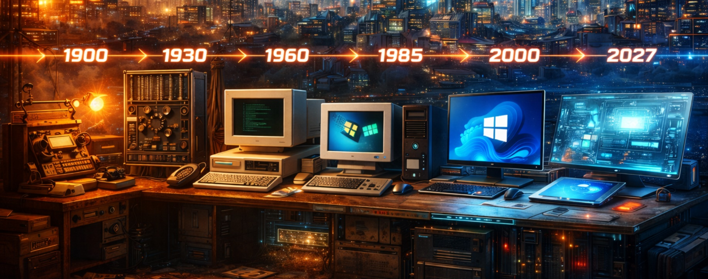
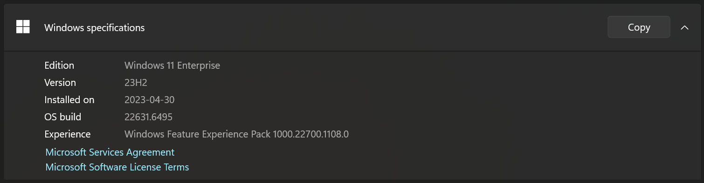

# Microsoft’s AI Strategy in Windows 11

> "How Productivity Tools Are Overloading Software Engineers"

## Introduction

Microsoft is transforming Windows 11 into an “AI-first” operating system. With the introduction of Copilot as a system-level assistant, Windows is no longer just a platform for applications, but an active participant in how users work, search, and make decisions. While this strategy promises productivity and accessibility improvements, it also raises serious questions about privacy, autonomy, and freedom of choice.

This article reviews Microsoft’s approach from a professional IT perspective and from the viewpoint of a PC owner who values privacy, personal rights, and control over their own device.

## What Microsoft Is Building

Microsoft’s stated goal is to make “every Windows 11 PC an AI PC.” Copilot is positioned as a central interaction layer rather than a standalone tool. Key elements of this strategy include:

- Voice-based interaction (“Hey Copilot”) to activate the assistant hands-free;
- Context-aware features that can analyze on-screen content to provide help;
- Early forms of task automation, where Copilot can perform actions with user permission;
- Deep integration into the taskbar, search experience, and core applications;

This represents a shift in philosophy: the operating system becomes proactive rather than passive.

## Positive Aspects ✅

**1. Productivity and convenience.** Natural language interaction can reduce friction for everyday tasks. Instead of navigating complex menus or settings, users can ask for help directly. For many non-technical users, this is genuinely helpful and time-saving.

**2. Accessibility improvements ♿.** Voice interaction and guided assistance can significantly help users with limited mobility, visual impairments, or difficulty using traditional interfaces. In this area, AI integration has clear social value. Context-aware help can improve onboarding, troubleshooting, and learning. In theory, this makes Windows more supportive and easier to use, especially for new users.

*[See the source list at the end for supporting evidence.]*

## Negative Aspects ⚠️

**1. Loss of autonomy through default behavior.** The most serious concern is not that AI exists, but that it is *enabled and promoted by default*. When Copilot is embedded into the taskbar and search, it becomes the primary interaction path.

Defaults matter. When an operating system strongly nudges users toward one way of working, it subtly shapes behavior. This affects freedom of will, even if users technically retain the ability to opt out.

**2. Increased privacy risk from “context awareness”.** To be useful, Copilot needs access to context: open files, visible screens, browser tabs, and application state. The broader this context becomes, the higher the risk of:

- cloud-based processing of sensitive data
- accidental disclosure through prompts or summaries
- over per missioning by users who just want the feature to work

Even without malicious intent, this expands the surface area for mistakes and misuse.

**3. Fragmented and unclear control.** Disabling or limiting AI features often requires navigating multiple settings across Windows, applications, and account-level configurations. From a privacy standpoint, this is problematic. If control is difficult to understand or audit, user consent becomes weaker. “You can turn it off” is not the same as “you clearly agreed to it.”

**4. Trust lags behind capability.** Microsoft emphasizes that many features are opt-in and permission-based. However, user trust depends on experience, not documentation. When AI features feel intrusive or overly visible, users naturally question how their data is handled - even if official policies say the right things.

## What Final Users Think 🗣️

User reactions are mixed but increasingly polarized:

- Some users welcome the convenience and see AI as a natural evolution.
- Privacy-focused users strongly object to default-on AI and voice-based interaction.
- Many users do not reject AI itself — they reject *forced adoption*, unclear boundaries, and the effort required to opt out.

The existence of popular guides explaining how to disable or remove AI features is a clear signal of discomfort among a significant group of users.

> I didn’t buy a PC to get a co-pilot I didn’t ask for. I bought it to be in control. Recent updates in Windows blur an important line not because AI exists, but because **choice is treated as optional**. When features that can see context, files, or behavior are enabled by default, that’s not assistance. That’s assumption. An operating system should be **neutral infrastructure**, not a guide with opinions, suggestions, and business incentives baked in. “You can disable it” is not the same as “you explicitly agreed to it.” Consent buried in settings isn’t real consent. This isn’t spying. It’s subtler and arguably worse. It **normalizes surveillance-adjacent behavior** and conditions users to accept it as progress. AI is fine. Automation is fine. **Forced AI is not!**
>
> I want my OS to stay quiet unless spoken to, to be local-first, and to obey me - not steer me.
> I still own the machine. I just don’t like passengers touching the wheel.

## How to Remove AI From Windows 11 (Using [RemoveWindowsAI](https://github.com/zoicware/RemoveWindowsAI))?

For users who value privacy, autonomy, and a clean, non-AI system experience, there’s an open-source project called RemoveWindowsAI on GitHub developed by zoicware. It is designed to help you disable or remove the majority of AI components that Microsoft has integrated into Windows 11.

### What RemoveWindowsAI Does

**RemoveWindowsAI** is a PowerShell-based tool that targets Windows 11’s built-in AI features, including:

- Copilot and related taskbar/search integrations
- Recall (screenshot-based search and context capture)
- AI services and background components
- AI-enhanced versions of built-in apps
- Registry keys and system packages related to AI functions
- Prevention of automatic reinstallation through Windows Update

This gives users the ability to significantly strip back AI functionality that would otherwise be difficult to remove through normal Settings menus.

### How It Works

1. **Run PowerShell as Administrator**

   The script must be executed from an elevated PowerShell console because it alters registry settings, AppX packages, and system components.

2. **Invoke the Script**

   You launch the script with a single command that pulls it from GitHub. Once started, it presents either a simple graphical interface (UI) or runs in a non-interactive mode, depending on your preference.

3. **Select What to Disable**

   The interface or command options allow you to choose which AI features you want to remove or disable. Copilot and Recall are common targets, but you can also disable AI in Notepad, Paint, voice/typing insights, and more.

4. **Optional Backup and Revert Modes**

   The script provides options to create backups before changes and to revert all modifications later if you change your mind.

5. **Manual Steps for Some Features**

   While the script is comprehensive, some AI elements — such as Gaming Copilot, OneDrive AI, or certain Windows Studio Effects — may require manual disabling through traditional system settings.

### Why This Matters

Because Microsoft does not currently provide a straightforward, complete way to opt out of all AI features in Windows 11, tools like RemoveWindowsAI have gained attention among users who want full control over what runs on their machines.

By automating registry edits, package removals, and update blockers, RemoveWindowsAI gives users a practical path to an AI-free system without waiting for Microsoft to add official toggles for every AI component.

## Conclusion

**No one has ever invested as much effort and marketing into promoting Linux as has been done for Windows.**

Microsoft’s AI strategy in Windows 11 is ambitious and technically sound. Integrating Copilot deeply into the operating system can deliver real benefits in productivity and accessibility.

However, from the perspective of a privacy-conscious PC owner and IT professional, the core issue is **control**.

AI assistance can be valuable ✅

AI assistance that is prominent by default, difficult to audit, and designed to influence workflows risks indirectly violating privacy and freedom of choice ⚠️

A healthier balance would treat AI as a clearly optional tool — enabled by explicit user choice, local-first where possible, and easy to disable without penalty. An operating system should serve the user. Not guide, train, or nudge them.

## Sources

1. Microsoft Windows Experience Blog – *Making every Windows 11 PC an AI PC*
2. Reuters – *Microsoft launches new AI upgrades for Windows 11*
3. Windows Central – *Copilot integration in Windows 11 taskbar and search*
4. PCWorld – *How to remove or reduce AI features in Windows 11*
5. Tom’s Hardware – *Copilot and browser-level AI integration*
6. Public user discussions on Reddit and technology forums regarding Windows 11 AI updates
7. RemoveWindowsAI – GitHub - <https://github.com/zoicware/RemoveWindowsAI>
