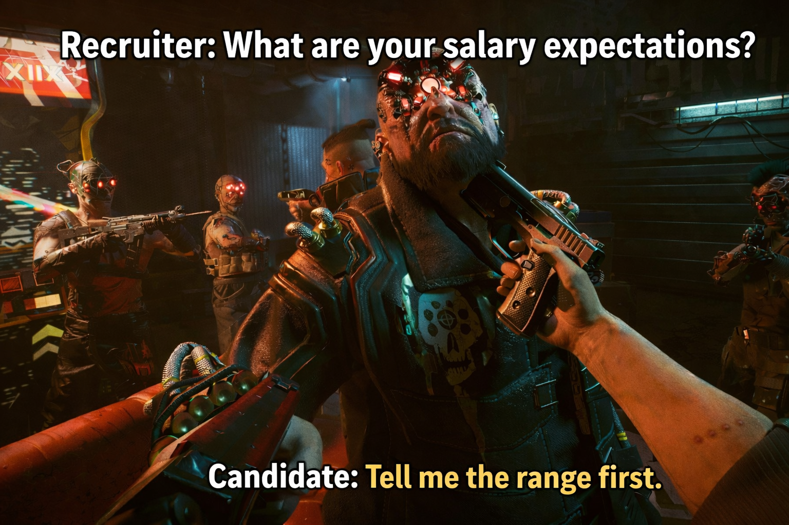
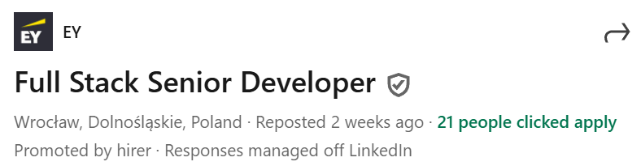
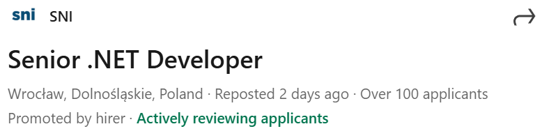
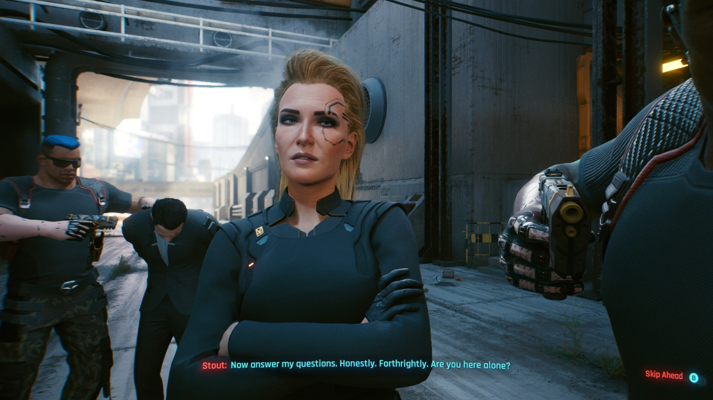

# Hiring in the First Quarter of 2026

> "The Old Rules Are Gone. The New Ones Are… **Complicated**"

## Introduction

With a decade of production experience, dozens of projects, multiple customers, broad technical expertise, certifications, and assessments — you will still go through the pain and seafaring of five interview stages for a new role.

And be sure: the more trivial the position looks, the more “checks” you’ll be required to pass.

So here I am — standing on the front line of job seekers testing what recruitment looks like in 2026 and what new challenges it brings, especially with the rise of AI.

Hi, my name is Serhii. I’m both a certified technical interviewer and a very active interviewee.

Since the beginning of 2026, I’ve participated in more than **20** interview sessions across **5** different roles.

This article is based on that experience.

I’ll share:

- how the hiring process has changed since last year,
- what new pitfalls have appeared,
- real examples of practical tasks and interview situations,
- and statistics I calculated from my past and failed interviews.

I’ll also highlight contract negotiation risks, including clauses that could cost you up to $10,000 before you even start your new position.

I’m not sure how relevant this article will be at the moment of being published. The world is unstable, and the market changes monthly.

Nevertheless, let’s dive in.

*[See the source list at the end for supporting evidence.]*

***WAKE UP SAMURAI, WE HAVE AN INTERVIEW TODAY!***

## How has the hiring process changed since 2025?

Cutoffs are the main strategy for many large corporations. With AI boosting developer productivity — some claim by as much as 80% — increasing the workload on the average developer suddenly seemed like a “good” idea. But that’s not the whole story. Despite layoffs and hiring freezes, many companies are still looking for new talents. The difference is how they are hiring compared to previous years.

Let’s start with positions. According to what I see on LinkedIn and other job platforms, junior roles have almost disappeared. The probability of finding an entry-level position is close to zero. Mid-level positions are slightly better — but still extremely rare. Even senior roles are not what they used to be. Salaries have noticeably decreased compared to 2025, while expectations and interview requirements have only increased. The market didn’t just slow down. It restructured itself, and not in favor of candidates.

We can understand this tendency: the number of candidates is higher than the number of open positions, and usually it is not difficult to find an expert for an open role. It is common to see more than 100 applicants for a single position. In such conditions, it becomes a highly competitive challenge just to be noticed.

**How do companies review all these applications?** The answer is simple: **they don’t**!

Instead, they use *AI scanners* and specialized tools placed in front of their recruitment systems. These tools filter candidates automatically, removing anyone whose CV is not a near-perfect match for the role. So, if your CV is not a strong match from the system’s point of view, *you can forget about even being noticed* [1].

Ok, ok — you made the adjustments, polished the corners, and now you have a noticeable CV that passed the initial filter. Are you safe now?

**NOPE!**

Compared with previous years, companies have started using the “Look-then-Leap” technique more often. This is a variation of the Secretary Problem, a classic puzzle in Optimal Stopping Theory [2].

### How the "Look-then-Leap" Rule Works?

The strategy is broken down into two distinct phases:

1. **The "Look" Phase (Setting the Baseline):** You interview the first portion of candidates (the "exploratory sample") without any intention of *hiring them*. Your only goal here is to gather data and determine who the "best so far" is. This becomes your **benchmark**.
2. **The "Leap" Phase (Making the Choice):** After you've passed the 37% mark, you continue interviewing. You hire the **very first person** who is better than everyone you saw in the "Look" phase.

Long story short, if you were in the first 37% of candidates, you will most likely be rejected even if you are a good match. You might think: if I am better than all of them and appear in that first 37%, I will be selected. Oh, my friend… This hiring process takes around one month. Even “urgent” positions are not that urgent anymore. Sadly.

Even if you were the best candidate, your result often becomes just another data point in the statistics, and the company may already forget about your existence by the time the process moves forward.

## Freaking Five Steps of Madness

If your CV survives the AI filters and the statistical lottery of the hiring funnel, the real adventure begins: the five-step interview process. For a Senior Software Engineer role, this has almost become the industry standard.

### Step 1 — HR Interview

The first stage is usually a conversation with HR. At this point they are not evaluating your technical skills. Instead, they check your general background, communication style, salary expectations, and — most importantly — your willingness to continue the process. In simple terms: are you stable, communicative, and not asking for *too much money*?

### Step 2 — External Technical Screening

Next comes technical screening, often performed through external platforms such as HackerRank, Codility, CodeSignal, or similar services. Here you are typically asked to solve algorithmic problems under time pressure. These tasks **often have little connection to the actual work** you will be doing, but they serve as a standardized filtering mechanism.

### Step 3 — Technical Interview

If you survive the automated test, you are invited to a technical interview with engineers from the team. This stage usually includes system design discussions, architecture questions, coding exercises, and deep dives into your previous experience. For senior roles, expectations are high — not only technical knowledge, but also decision-making, trade-offs, and communication.

### Step 4 — Manager Interview

After the technical evaluation, you will likely meet the engineering manager or team lead. This conversation focuses on responsibility, leadership, collaboration style, and how you would fit into the team structure.

### Step 5 — Client Interview

In outsourcing or consulting companies, there is often one more stage: the client interview. At this point, the client decides whether they want to work with you on their project. Even if you passed all previous stages, the final decision may still depend on this meeting.

### Final Proposal

If everything goes well, the company prepares a final offer. However, the process may still include additional checks such as **background verification, criminal record checks, or medical examinations** — sometimes even **drug** testing, depending on the company and the country.

Yes. All of this… just to write code...

## Contract Review and Negotiations

You survived the five-step madness. You got an offer. Congratulations. Now, don’t relax — the real trap is the contract. Even a “perfect” offer can turn into a nightmare if you don’t pay attention to the details. Here’s what you need to watch carefully:

**1. Salary and Bonuses.** Make sure the numbers are explicit: base salary, bonuses, stock options (if any). Watch for vague wording like “performance-based bonus” without clear KPIs — it’s a loophole for the company to *pay nothing*. Even benefits like catering or vacation, day-offs should be written if not in the main contract they can be attached as a separate section.

**2. Probation Periods.** Check the length and conditions. Some companies use probation to terminate early without notice. Confirm if benefits and rights apply during probation.

**3. Notice Period.** How long do you need to give notice if you leave? How long is the company’s notice period? Make sure these match local labor laws.

**4. Non-Compete / Restriction Clauses.** Watch out for clauses restricting your future employment. Some “non-compete” agreements can prevent you from working in your field for months after leaving. Negotiate limits in time, geography, and scope.

**5. Additional Checks.** Criminal checks, medical exams, drug tests — make sure they are clearly described in the contract. Any cost or consequences for failing these should be explicit.

**6. Hidden Fees or Penalties.** Some contracts have repayment clauses for training, relocation, or early termination. Verify maximum liability. Don’t let the company demand $10k or more if you leave early.

**7. Intellectual Property / Ownership.** Ensure IP clauses are reasonable. As a senior engineer, you want to avoid giving away personal projects or open-source contributions.

> **PRO TIP:** Always read the contract line by line. Highlight anything unclear and discuss it before signing. Don’t assume “standard wording” is safe — it might be a **trap**.
>
> Use AI analytics to check your assumptions. Assign a risk score from 1 to 10 for each clause. The lower the score, the safer it is to sign.

From my experience, I almost fell into this trap. This year I had a very attractive offer. Everything seemed standard, but when I analyzed it with AI, it revealed a hidden clause in the **“Responsibility of the Parties”** section. It stated that I would be responsible for company contracts and terms, and if I failed to deliver for any reason, I would have to cover costs, including the use of external libraries, up to **$100,000**. For a position with a **$7,000 monthly salary**, that’s insane.

***Remember: passing interviews is hard, but signing the wrong contract is even harder to recover from.***

## Summary

The market has changed — salaries are shrinking, entry-level positions are disappearing, and competition is fiercer than ever. Knowing the pitfalls, staying alert, and preparing strategically is the only way to survive the new hiring world.

## References

1. The Top Seven Trends That Will Define Technology Hiring in 2026 – <https://tier4group.com/the-top-seven-trends-that-will-define-hiring-2026/>
2. Algorithms To Live By #2: Optimal Stopping - How Long To Look For And When To Stop To Find The Best (The 37% Rule) - <https://steemit.com/algorithmstoliveby/@capatazche/algorithms-to-live-by-2-optimal-stopping-how-long-to-look-for-and-when-to-stop-to-find-the-best-the-37-rule>
