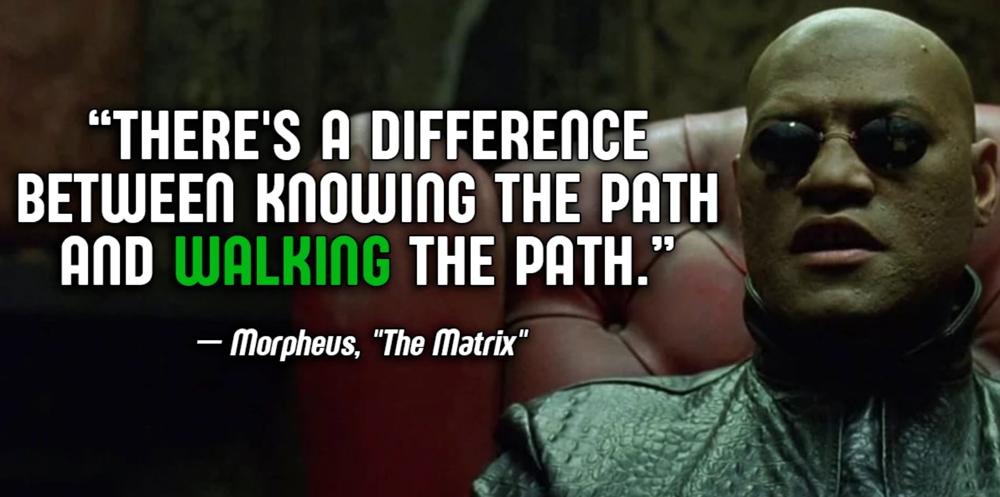

# AI Adoption for Software Engineers

> "**Maximize** impact, **minimize** cost"

## Introduction

First quarter of 2026 ended with controversial results. New LLMs keep appearing, while companies still rely on marketing tactics from seven years ago. The reality, however, is different: older models are being degraded to push users toward newer ones — a dirty trick.

What used to be good and free is now slow, laggy, and creates more problems than it solves. Meanwhile, the “new” solutions are fast and effective — for now — but come at a high cost, and there is little reason to expect prices to drop anytime soon.

We are now in a reality where companies that adopted AI-driven development are spending far more than expected. For instance, Uber reportedly burned through its annual budget in a single quarter. An awkward situation, isn’t it? [1][2] To be truly effective, you need to select the right strategy. I can help with that but remember everything depends on your choice.



How do you actually make AI do what you asked for, instead of what it thought you meant? How do you cut token usage per task without the context turning into a chaotic soup of half-forgotten instructions? How do you get consistent, reliable results from smaller prompts that don’t collapse under their own ambiguity? And how do you orchestrate agents properly—without accidentally spawning a small digital civilization of AI clones arguing with each other?

This article will unpack all of that.

**Primary Sources & Links**

1. Why Uber has Already Burned Through its AI Budget — <https://aimagazine.com/news/why-uber-has-already-burned-through-its-ai-budget>
2. A Manager's Guide to Reducing AI Costs Without Reducing Headcount — <https://www.productcurious.com/p/uber-ai-budget-mistake>

## Problem Decomposition

Even small changes in a large codebase can explode in complexity. What looks like a narrow task often requires understanding surrounding services, shared utilities, and implicit business rules scattered across multiple layers — forcing the AI to load a disproportionately large context window just to answer a scoped question.

This is more **expensive** in more than one way. Every redundant token adds latency and cost. But more critically, model attention is not uniform across long sequences — performance grows increasingly unreliable as input length grows. **More context doesn't mean better answers**; it often means worse ones.

The root cause is a structural mismatch: large codebases are organized around architecture and history, not task boundaries. These forces repeated context rehydration — the same files, abstractions, and dependencies get revisited session after session, even when they're not directly relevant.

This happens because AI has no persistent “memory” of what you are doing. Each session effectively starts from scratch whenever it needs to reconstruct the required context. It does not know where the relevant information is located or how to efficiently retrieve it, so it ends up pulling in large amounts of data until it reaches a point where it can safely proceed.

The fix shifts from full context understanding to targeted context isolation:

- Break tasks into minimal, self-contained units of work
- Enforce strict relevance filtering before context injection
- Cache or summarize stable parts of the system instead of reloading them
- Design prompts that reference interfaces and contracts, not full implementations

The goal isn't to make the AI know everything — it's to ensure it only sees what's strictly necessary to solve the current problem.

In large systems, efficiency is not about bigger context windows. It is about better decomposition. I will show you how to achieve it.


To scope this problem, let’s take a simple case: fixing SonarQube or lint issues in a large legacy codebase. On the surface, it’s straightforward—find issues and fix them. In reality, findings are spread across subsystems, classes, and files, and each fix may depend on shared abstractions or hidden dependencies. Even small, automated fixes can trigger large context loading. To safely change one file, the system often needs related utilities, interfaces, and dependent modules. As a result, the context window quickly expands far beyond the actual task. What should be a local fix becomes a global exploration problem, where token usage grows not with task complexity, but with poor context boundaries.

### AI Directory Structure

Start by setting up a dedicated metadata folder for your AI tooling. Most AI tools impose their own conventions — `.cursor/` for Cursor, `.claude/` for Claude, `.github/copilot-instructions.md` for Copilot. This fragmentation makes it hard to share context across tools or onboard new team members consistently.

A better approach: standardize on a single `./ai` directory at the repository root as the canonical source for all AI-related artifacts.

- `agents/` - Agent definitions and role configurations
- `skills/` - Reusable task instructions and capabilities
- `prompts/` - Prompt templates, versioned by use case
- `workflows/` - Multi-step orchestration configurations
- `context/` - Stable system summaries, architecture notes, glossaries

Keeping this separate from application code has two concrete benefits. First, it enforces the boundary between what the system does and how AI is instructed to work with it — changes to one don't pollute the other. Second, it stays in control, which matters more than it might seem prompts drift, agent behavior changes, and you'll want a git history when something breaks silently.

Treat `./ai` the way you'd treat a `./docs` or `./scripts` folder — not an afterthought, but a first-class part of the repository structure.

Remember AI tools don't automatically "know" your `./ai` folder exists. You must explicitly wire it in. The main approaches:

**CLAUDE.md (Claude-specific).** Claude Code looks for a `CLAUDE.md` file at the repo root automatically — no configuration needed. This is your primary relay point. Instead of duplicating content, use it as an index:

```markdown
# Project Context
- Architecture overview: ./ai/context/architecture.md
- Coding conventions: ./ai/context/conventions.md
- Available agents: ./ai/agents/
- Common workflows: ./ai/workflows/
```

Claude reads this at the start of every session and knows where to look.

**MCP servers (most powerful).** This is where it gets serious. You can expose your `./ai` directory as an MCP (Model Context Protocol) server — Claude then has a *tool* to query artifacts on demand rather than loading everything upfront. Relevant context gets pulled only when needed, which directly solves the decomposition problem from earlier chapter.

### Task Decomposition in Practice

**1. The unit of work definition.** Start with a concrete rule of thumb — a well-decomposed task should have:

- A single, verifiable output
- A bounded set of files it touches
- No ambiguous success criteria

Bad example vs good example side by side:

| ❌ Bad | ✅ Good |
|----|----|
| "Refactor the auth module" | "Extract token validation logic from AuthService into a standalone TokenValidator class with the same interface — no behavior changes" |

**2. Use decomposition patterns.** Three patterns worth naming explicitly:

- **Vertical slice** — one feature, end to end (route → service → repo → test). AI stays in one domain.
- **Horizontal layer** — one layer across features (all DTOs, all interfaces, all tests). Repetitive tasks AI handles well.
- **Dependency-first** — start from leaf nodes (no dependencies), work inward. Safest for refactoring.

This is where most developers lose value. A decomposed task still fails if the prompt is vague. Show a prompt template:

```text
Context: [one paragraph, what this unit touches]
Task: [single action verb — extract, rename, add, fix]
Boundaries: [what NOT to touch]
Output: [exactly what you expect back]
Done when: [verifiable condition]
```

To recognize if task is too large check next:

- The prompt needs "and then" more than once
- You can't describe the output in one sentence
- It touches more than 3–4 files across different domains
- You'd need to explain business context before the technical task

To make this practical, consider a common scenario: you have a legacy system with a list of SonarQube issues to fix. The naive approach is to open the project in an AI tool like Cursor or Claude Code and ask it to resolve everything at once. This is exactly what you should not do.

Instead, you need to create workflow definition, drop it into `./ai/workflows/` and a ready-to-use Cursor prompt.

**References**

1. AI workflows: How to actually use AI in your business - <https://zapier.com/blog/ai-workflows/>
2. Agents in Workflows - <https://learn.microsoft.com/en-us/agent-framework/workflows/agents-in-workflows?pivots=programming-language-csharp>

First, the workflow file — save this as `./ai/workflows/sonarqube-fix.md`:

```markdown
# Workflow: SonarQube Issue Fix

## Boundaries
- ONLY modify files explicitly listed in the issue list
- NO refactoring beyond what SonarQube flags
- NO changes to unrelated tests

## Steps
1. BRANCH
   - Fetch latest master
   - Create branch: fix/sonarqube-{YYYY-MM-DD}
2. ANALYZE
   - Read the full issue list before touching any file
   - Group issues by file
   - For each file, identify the minimal change needed
3. FIX (file by file)
   - Open file
   - Fix only flagged issues — nothing else
   - Do not change surrounding logic, formatting, or imports unless flagged
4. TEST
   - Run: npm test
   - If failures appear, check if they relate to changed files only
   - Fix failing tests — do not modify passing tests
5. COMMIT
   - Message format: fix(sonarqube): resolve issues in {file1}, {file2}...
   - Push branch to origin

## Done when
- All listed issues addressed
- npm test passes
- Branch pushed
```

After this your prompt will look like:

```text
Follow the workflow defined in ./ai/workflows/sonarqube-fix.md exactly.

ISSUE LIST:
- src/services/AuthService.ts — [paste issues]
- src/utils/tokenHelper.ts — [paste issues]
- src/controllers/UserController.ts — [paste issues]
- src/models/UserModel.ts — [paste issues]

RULES:
- Visit only the 4 files above, in order
- Fix only what is listed — no opportunistic cleanup
- After all fixes: run npm test
- If tests fail, fix only tests related to changed files
- Commit with message: fix(sonarqube): resolve issues in AuthService,
  tokenHelper, UserController, UserModel
- Push branch to origin

Do not proceed to the next file until the current one is complete.
Report what you changed in each file before moving on.
```

## Consistent Results Without Blowing the Budget: Pick the Right Model for the Job

Here's a mistake almost every team makes in the first month of AI-assisted development: they route everything through the most powerful model available. Every lint fix, every docstring, every "rename this variable" goes to the same frontier model that you'd use to architect a distributed system from scratch. It's like hiring a principal engineer to sort your import statements. Technically effective. Financially indefensible.

The uncomfortable truth is that model capability and model cost scale together and most of your daily tasks don't need the top of that curve. LLM providers now offer a clear tiered landscape, and treating it as a single-tier system is where budgets quietly bleed out.

A practical way to think about it: tasks fall into roughly three buckets.

**Mechanical tasks** — formatting, renaming, boilerplate generation, simple test scaffolding, fixing well-defined lint issues. These have a correct answer that doesn't require reasoning about intent. A smaller, faster, cheaper model handles these reliably. Haiku, GPT-4o mini, Gemini Flash — pick whichever fits your stack. The output quality difference compared to a frontier model is negligible for these tasks, and the cost difference is not.

**Reasoning tasks** — refactoring with implicit constraints, debugging across service boundaries, explaining non-obvious behaviour in legacy code, writing tests for undertested edge cases. These benefit from a mid-tier model. You want something that can hold context and reason about it, but you don't necessarily need the full weight of a frontier model for every step.

**Architectural tasks** — system design, evaluating tradeoffs, reviewing pull requests for correctness and design issues, generating solutions where there isn't an obvious right answer. This is where the flagship models earn their cost. Use them deliberately, not by default.

The practical implementation is simpler than it sounds. In your `./ai` directory, define model assignments per workflow type. If you're using Claude Code, you can set model preferences per task type in your configuration. If you're building your own pipeline, a routing layer that classifies the incoming task before dispatching it is half a day's work and pays for itself within a week.

One concrete heuristic: if you can write a unit test that checks whether the output is correct, it's a mechanical task. If correctness requires judgment, it's reasoning or architectural. That distinction alone will redirect a significant share of your token spend to cheaper models without any visible drop in output quality.


The goal isn't to use the cheapest model for everything it's to stop using the most expensive one for things that don't need it.

## Orchestrating Agents Without Accidentally Starting a Committee

At some point, a single AI doing one thing at a time stops being enough. You have a pipeline — generate a spec, implement it, write tests, review the result, fix what's broken — and you want each step handled by an agent tuned for that task. This is where multi-agent orchestration enters the picture, and where things get interesting in ways you didn't ask for.

The failure mode nobody warns you about isn't agents getting things wrong. It's agents getting things almost right and then confidently handing off broken work to the next agent, which builds on it, which hands it off again. By the time the pipeline finishes, you have a beautifully structured, thoroughly documented, completely incorrect result — and no single agent that visibly failed. The error was distributed.

The root cause is almost always the same: agents without clear contracts. When each agent's input format, output format, and failure conditions are ambiguous, the pipeline becomes a game of telephone. Each handoff introduces drift, and drift compounds.

The fix is boring, which is why it works. Treat agent handoffs like API contracts. Define them explicitly, version them, and validate them at each step. Concretely:

- Every agent receives a structured input — not freeform instructions, but a defined schema. What files it can touch, what it's expected to produce, what it must leave unchanged.
- Every agent produces a structured output that the next agent can verify before proceeding. A JSON envelope with a status field, a summary of changes, and an explicit "ready for next step" flag is enough.
- Failures are surfaced immediately and loudly, not swallowed. An agent that can't complete its task should stop the pipeline and report why, not try to work around the problem and silently degrade the output.

### A practical example: the spec-to-PR pipeline

Here's a four-agent workflow for implementing a small, well-scoped feature — the kind you'd normally hand to a junior developer with good instructions.

Save this as `./ai/workflows/spec-to-pr.md`:

```markdown
# Workflow: Spec to Pull Request

## Agents

### 1. Spec Agent
Input: feature description (plain text)
Task: Produce a structured implementation spec
Output:
- files_to_create: list
- files_to_modify: list
- interfaces_to_define: list
- acceptance_criteria: list
- out_of_scope: list (explicit)
Done when: spec reviewed and approved (human checkpoint)

### 2. Implementation Agent
Input: approved spec from Agent 1
Task: Implement only what the spec defines
Boundaries:
- ONLY touch files listed in spec
- NO changes beyond spec scope
- NO opportunistic refactoring
Output: list of changed files with summary of changes per file
Done when: all spec items implemented, no out-of-scope changes

### 3. Test Agent
Input: implementation output from Agent 2
Task: Write or update tests for changed behavior
Boundaries:
- Tests must cover acceptance criteria from spec
- Do NOT modify implementation files
- Do NOT fix failing tests by weakening assertions
Output: list of test files created or modified
Done when: npm test passes

### 4. Review Agent
Input: spec + implementation output + test output
Task: Verify implementation matches spec
Check:
- Every acceptance criterion has a corresponding test
- No out-of-scope files were modified
- No TODOs or placeholder comments remain
Output:
- status: PASS or FAIL
- issues: list (empty if PASS)
Done when: status is PASS — then commit and push branch
```


The prompt you hand to Claude Code or Cursor to run this is deliberately short:

```text
Follow ./ai/workflows/spec-to-pr.md exactly.
Feature: [one paragraph description]
Execute agents in sequence. Do not proceed to the next agent
until the current one outputs a complete result.
Stop and report if any agent cannot complete its task.
Do not attempt to recover silently.
```

Notice what this workflow does not do: it does not let agents talk to each other freely, improvise on ambiguous input, or decide for themselves when a step is "good enough." The structure is the constraint, and the constraint is the point.

Multi-agent systems get complicated fast. The teams that get reliable results from them aren't the ones with the most sophisticated agents — they're the ones who spent the most time designing the handoffs.

## Trimming the Fat: Use graphs to cut your AI token bill

If you've ever watched an AI burn through your token budget just to answer a simple question about a function buried somewhere in a 200-page codebase, you already understand the problem. The AI doesn't know what's relevant, so it reads everything. That's expensive, slow, and honestly a bit embarrassing for a technology that's supposed to be smart.

The fix, it turns out, isn't a bigger context window. It's a smarter one. And that's exactly where knowledge graphs come in. Instead of feeding the model raw text — walls of documentation, entire files, sprawling transcripts — you distill that information into a structured network of nodes (the entities: functions, services, people, concepts) and edges (the relationships between them: "calls", "depends_on", "owned_by"). When your AI needs to answer something, you don't hand it the whole filing cabinet. You hand it the specific folder it asked for. [1][2][3]

### Step 1: Build the Core Pipeline

The first question most people ask is: "How do I even turn a pile of documents into a graph?" The good news is that the process is well-defined, even if it takes a bit of setup. [4]

It starts with entity and relationship extraction — which is a fancy way of saying: read the text, find the things, find how they connect. You can do this with an LLM (ask it to return JSON triples like

```json
{"subject": "UserAuth", "predicate": "depends_on", "object": "TokenService"}
```

), or lean on established NLP libraries like SpaCy if you're working at scale and want something fast and deterministic.

Once you've extracted your entities, you'll quickly notice that "Claude", "Anthropic's model", and "the assistant" all refer to the same thing. This is the entity resolution problem, and skipping it is how you end up with a bloated, redundant graph where the same concept lives under fifteen slightly different names. Collapsing these into a single canonical node keeps your graph clean and queryable.

Finally, all of this needs to live somewhere. For production use, Neo4j is the gold standard — it's purpose-built for graph traversal and handles complex relationship queries elegantly. For smaller projects or local prototyping, a simple SQLite table with a `subject | predicate | object` schema works surprisingly well and has essentially zero infrastructure overhead. [5][6][7][8][9][10]

### Step 2: Implement Token Reduction Strategies

Here's where the real magic happens. Once your knowledge graph exists, it becomes what you might think of as a Semantic Firewall — a layer that intercepts vague, noisy requests and returns only the precise information the model actually needs. [11][12]

**Sub-graph retrieval (GraphRAG)** is probably the most impactful technique. Traditional vector search does a "Top-K" similarity lookup: it finds the K most semantically similar chunks and throws them all into the prompt, relevant or not. GraphRAG is different — you query the graph for specific relationships (e.g., "what services does PaymentModule depend on?") and get back a tightly scoped subgraph. The result? One team reported cutting token usage by over 40× in coding tasks simply by pulling relevant function signatures and their direct dependencies rather than entire source files. [13][14]

**Hierarchical summarization** tackles the overview problem. Sometimes you don't need the details — you need the map. By grouping related nodes into clusters and pre-computing short summaries of each cluster, you can serve the AI a 100-token "chapter overview" instead of 5,000 tokens of raw content. The model can then drill down into whichever cluster is relevant, rather than reading the whole book to find one paragraph.

**Multi-hop reasoning** is perhaps the subtlest but most powerful of the three. Documents are linear; knowledge is not. A relationship between two concepts might span three separate files that are physically nowhere near each other. A graph can surface that connection in a single traversal, saving you from the painful workaround of dumping every possibly-relevant document into the context window and hoping for the best. [15][16][17]

### Step 3: Use Automated Frameworks (If You Don't Want to Build From Scratch)

Rolling your own knowledge graph pipeline is completely doable — but there are already several tools that do the heavy lifting. [18]

**Cogni** is an open-source engine designed to replace traditional vector stores altogether. It takes unstructured text as input and produces a dynamic, queryable graph structure that you can slot directly into your retrieval pipeline. No manual triple extraction required.

**The Claude Cookbook** has a practical guide on using structured outputs to extract subject–predicate–object triples and assemble them into an in-memory graph. It's a great starting point if you want to understand the fundamentals before committing to any particular framework. [19]

**DataCharvis.ai** takes a zero-code approach — upload a transcript or document, and it automatically extracts entities and relationships, then gives you a visual, navigable graph of your data. Useful for quick exploration or for teams that don't have a dedicated ML engineer on hand. [20]

## Summary

> *AI tools are only as good as the strategy behind them. This article is about building that strategy — so your AI stops reading everything, stops guessing what you meant, and stops running up a bill that's hard to explain to anyone holding a budget.*

## References

1. Token Optimization Strategies — <https://tetrate.io/learn/ai/mcp/token-optimization-strategies>
2. How Data Professionals Can Boost Their AI Workflow with Prompt Engineering — <https://dataquestio.medium.com/how-data-professionals-can-boost-their-ai-workflow-with-prompt-engineering-5a0480966e4f>
3. Graph RAG vs Vector RAG: Why Your AI Needs a Brain, Not Just a Library — <https://medium.com/@adityathakare72/graph-rag-vs-vector-rag-why-your-ai-needs-a-brain-not-just-a-library-ca0e896c2907>
4. Building a Knowledge Graph: A Comprehensive End-to-End Guide — <https://medium.com/@brian-curry-research/building-a-knowledge-graph-a-comprehensive-end-to-end-guide-using-modern-tools-e06fe8f3b368>
5. How to Build a Knowledge Graph — Neo4j Blog — <https://neo4j.com/blog/knowledge-graph/how-to-build-knowledge-graph/>
6. Constructing Knowledge Graphs from Text Using OpenAI Functions — LangChain — <https://www.langchain.com/blog/constructing-knowledge-graphs-from-text-using-openai-functions>
7. Knowledge Graph Creation — Memgraph Docs — <https://memgraph.com/docs/ai-ecosystem/graph-rag/knowledge-graph-creation>
8. Claude Cookbook: Knowledge Graph Guide — <https://platform.claude.com/cookbook/capabilities-knowledge-graph-guide>
9. Knowledge Graph Tutorial (Video) — <https://www.youtube.com/watch?v=sD7huYX078E&t=52>
10. I Built a Knowledge Graph That Cuts Claude Code's Token Usage by 49× — <https://tirthkanani18.medium.com/i-built-a-knowledge-graph-that-cuts-claude-codes-token-usage-by-49x-ca73ef078981>
11. Stop Dumping Junk Into Your Context Window — <https://dev.to/mosiddi/stop-dumping-junk-into-your-context-window-the-case-for-multidimensional-knowledge-graphs-4e3o>
12. Semantic Filtering in Knowledge Graphs — ScienceDirect — <https://www.sciencedirect.com/science/article/pii/S1047320322001493>
13. GraphRAG Explained (Video) — <https://www.youtube.com/watch?v=XNneh6-eyPg&t=14>
14. GraphRAG Deep Dive (Video) — <https://www.youtube.com/watch?v=AnyCu-BgZcE&t=693>
15. Tips to Maximize LLM Context Usage — LinkedIn — <https://www.linkedin.com/top-content/user-experience/chatgpt-usage-tips/tips-to-maximize-llm-context-usage/>
16. Knowledge Graph vs RAG — PuppyGraph — <https://www.puppygraph.com/blog/knowledge-graph-vs-rag>
17. I Built a Knowledge Graph That Cuts Claude Code's Token Usage by 49× — <https://tirthkanani18.medium.com/i-built-a-knowledge-graph-that-cuts-claude-codes-token-usage-by-49x-ca73ef078981>
18. From Local Knowledge Graph to Global Community — arXiv — <https://arxiv.org/abs/2308.02622>
19. Claude Cookbook: Knowledge Graph Guide — <https://platform.claude.com/cookbook/capabilities-knowledge-graph-guide>
20. DataCharvis.ai Demo (Video) — <https://www.youtube.com/watch?v=_gSXqf57hjE>
