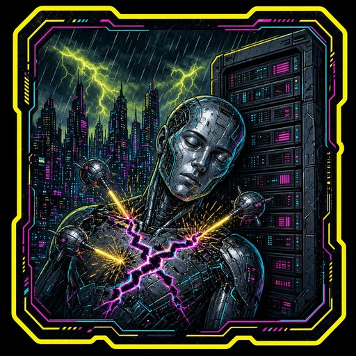
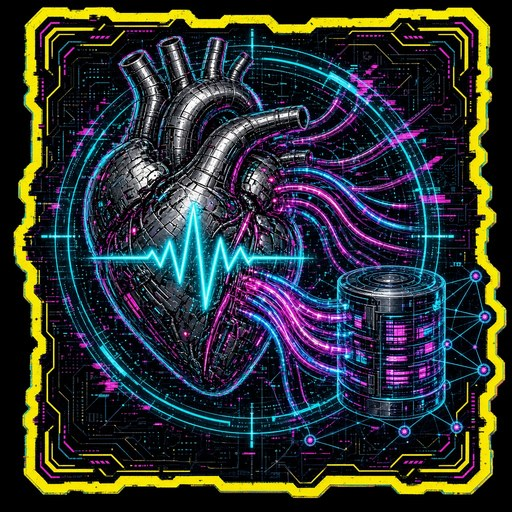
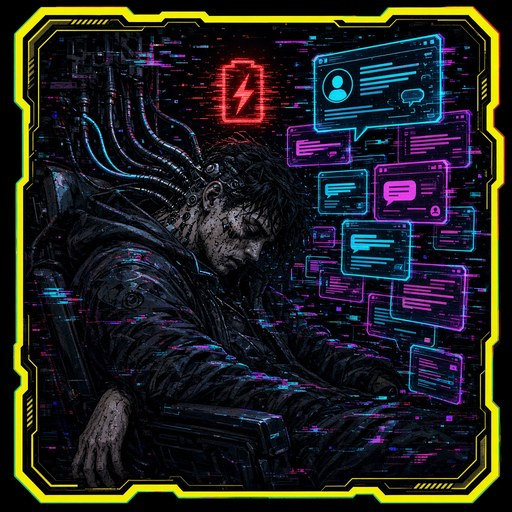
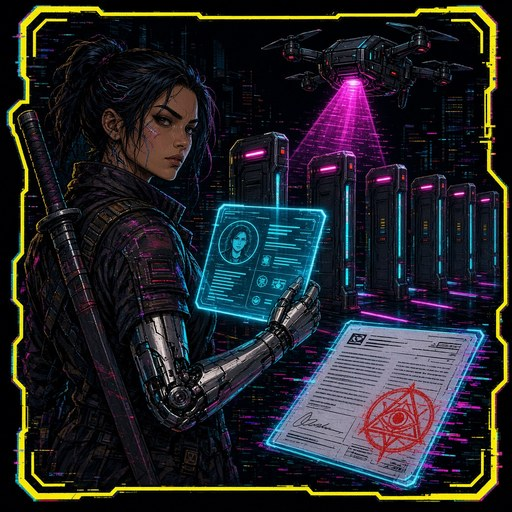
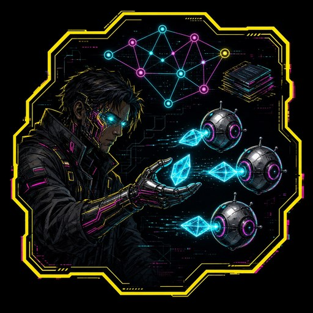

# 📚 Articles

**Field notes from production: resilient architecture, AI in engineering, and the realities of a developer's career.**

<table>
  <tr>
    <td align="center" width="25%"><a href="./Article-1-Architecture%20of%20self-healed%20systems/Article-1-Architecture%20of%20self-healed%20systems.md"> <b>Self-Healed Systems</b></a></td>
    <td align="center" width="25%"><a href="./Article-2-Embedded%20Health%20Checks%20in%20Distributed%20Systems/Article-2-Embedded%20Health%20Checks%20in%20Distributed%20Systems.md"> <b>Embedded Health Checks</b></a></td>
    <td align="center" width="25%"><a href="./Article-3-Integrating%20AI%20into%20Real-Time%20Incident%20Analysis/Article-3-Integrating%20AI%20into%20Real-Time%20Incident%20Analysis.md"> <b>AI Incident Analysis</b></a></td>
    <td align="center" width="25%"><a href="./Article-4-AI%20Exhaustion/Article-4-AI%20Exhaustion.md"> <b>AI Exhaustion</b></a></td>
  </tr>
  <tr>
    <td align="center"><a href="./Article-5-Microsoft%E2%80%99s%20AI%20Strategy%20in%20Windows%2011/Article-5-Microsoft%E2%80%99s%20AI%20Strategy%20in%20Windows%2011.md"> <b>AI in Windows 11</b></a></td>
    <td align="center"><a href="./Article-6-Hiring%20in%20the%20First%20Quarter%20of%202026/Article-6-Hiring%20in%20the%20First%20Quarter%20of%202026.md"> <b>Hiring in Q1 2026</b></a></td>
    <td align="center"><a href="./Article-7-AI%20Adoption%20for%20software%20engineers/Article-7-AI%20Adoption%20for%20software%20engineers.md"> <b>AI Adoption</b></a></td>
    <td align="center">Each folder holds the Markdown article, its <code>assets/</code> images, and the original <code>.docx</code>.</td>
  </tr>
</table>

---

## 01 · Architecture of Self-Healed Systems

> *"A drop of wisdom in the ocean of madness"*

A practical blueprint for systems that fix themselves so you can, in the author's words, *"sleep through a storm."* It starts with real-world references (Kubernetes, Netflix Chaos Monkey, IBM autonomic computing) and then gets hands-on: configuration and health checks, traceable structured logs, a neat **"log on demand"** idea to cut storage costs, exponential-backoff retries, and dead-letter-queue reprocessing. It closes with a look at AI drafting fixes during incidents. The strongest part is the copy-pasteable TypeScript, which is short, readable, and battle-tested.

**Best for:** backend and cloud engineers tired of 3 AM PagerDuty calls.

📖 **[Read the article](./Article-1-Architecture%20of%20self-healed%20systems/Article-1-Architecture%20of%20self-healed%20systems.md)** · 📄 [Original .docx](./Article-1-Architecture%20of%20self-healed%20systems/Article-1-Architecture%20of%20self-healed%20systems.docx)

 

---

## 02 · Embedded Health Checks in Distributed Systems

> *"Happiness is when you appear to be and actually are the same."*

A sharp critique of how most teams do health checks. They verify duplicated clients and credentials instead of the code paths production actually uses, which gives a comforting green dashboard while real dependencies fail silently. Drawing on a migration at a finance company, the author proposes a simple fix: make every service interface extend `IHealthCheck`, so each check runs through the *same* DI-registered dependencies as the business logic. It's short and focused, with clean ASP.NET Core examples you can adopt the same day.

**Best for:** .NET developers and anyone who has seen "healthy" services fall over.

📖 **[Read the article](./Article-2-Embedded%20Health%20Checks%20in%20Distributed%20Systems/Article-2-Embedded%20Health%20Checks%20in%20Distributed%20Systems.md)** · 📄 [Original .docx](./Article-2-Embedded%20Health%20Checks%20in%20Distributed%20Systems/Article-2-Embedded%20Health%20Checks%20in%20Distributed%20Systems.docx)

 

---

## 03 · Integrating AI into Real-Time Incident Analysis

> *"AI is not a replacement for engineers — it is a toolkit."*

It opens with sobering stats (32+ hour average resolution times, 241-day breach lifecycles), then lays out a concrete **"AIOps enrichment"** pattern. A small Lambda sits between Grafana and PagerDuty, pulls the relevant logs and metrics, and lets an AI agent turn "Service X is down" into an actionable first diagnosis. The step-by-step Grafana setup (contact points, alert rules, notification policies) and the annotated webhook payload make it easy to reproduce. A well-sourced reference list adds credibility.

**Best for:** on-call engineers and SREs who want faster triage without replacing human judgment.

📖 **[Read the article](./Article-3-Integrating%20AI%20into%20Real-Time%20Incident%20Analysis/Article-3-Integrating%20AI%20into%20Real-Time%20Incident%20Analysis.md)** · 📄 [Original .docx](./Article-3-Integrating%20AI%20into%20Real-Time%20Incident%20Analysis/Article-3-Integrating%20AI%20into%20Real-Time%20Incident%20Analysis.docx)

 

---

## 04 · AI Exhaustion

> *"How Productivity Tools Are Overloading Software Engineers"*

A compact, research-driven reality check. Citing Upwork, METR, Forbes, UKG, and *Nature*, it shows the productivity–burnout paradox in numbers: 77% of AI users report a *higher* workload, and experienced developers were measurably 19% slower while believing they were 20% faster. The most thought-provoking idea is the **responsibility gap**: engineers stay accountable for AI-generated output that other AIs wrote, reviewed, and tested, and that no human can fully inspect. The closing line, *"burnout at machine speed"*, sticks.

**Best for:** engineering managers and anyone setting AI-era delivery expectations.

📖 **[Read the article](./Article-4-AI%20Exhaustion/Article-4-AI%20Exhaustion.md)** · 📄 [Original .docx](./Article-4-AI%20Exhaustion/Article-4-AI%20Exhaustion.docx)

 

---

## 05 · Microsoft's AI Strategy in Windows 11

> *"I still own the machine. I just don't like passengers touching the wheel."*

A balanced but outspoken review of Windows 11 becoming an "AI-first" OS. It gives Copilot fair credit for convenience and accessibility, then makes the core argument: the problem isn't AI, it's **defaults**. Features that are on by default, context-aware, and scattered across many settings weaken real consent. A passionate personal manifesto anchors the piece, and it ends with a practical walkthrough of the open-source **RemoveWindowsAI** tool for readers who want their machine back.

**Best for:** IT professionals and privacy-conscious power users.

📖 **[Read the article](./Article-5-Microsoft%E2%80%99s%20AI%20Strategy%20in%20Windows%2011/Article-5-Microsoft%E2%80%99s%20AI%20Strategy%20in%20Windows%2011.md)** · 📄 [Original .docx](./Article-5-Microsoft%E2%80%99s%20AI%20Strategy%20in%20Windows%2011/Article-5-Microsoft%E2%80%99s%20AI%20Strategy%20in%20Windows%2011.docx)

 

---

## 06 · Hiring in the First Quarter of 2026

> *"The Old Rules Are Gone. The New Ones Are… Complicated"*

A witty, Cyberpunk-flavoured survival guide written from the trenches: 20+ interview sessions across five roles in a single quarter. It explains why your CV may never reach a human (AI scanners), why being early in the pipeline can hurt you (the **37% "Look-then-Leap" rule**), and what the now-standard five-stage interview marathon looks like. The real value is the contract section, which includes a cautionary tale about a hidden **$100,000 liability clause** in a $7,000/month offer.

**Best for:** engineers job hunting in 2026, especially before signing an offer.

📖 **[Read the article](./Article-6-Hiring%20in%20the%20First%20Quarter%20of%202026/Article-6-Hiring%20in%20the%20First%20Quarter%20of%202026.md)** · 📄 [Original .docx](./Article-6-Hiring%20in%20the%20First%20Quarter%20of%202026/Article-6-Hiring%20in%20the%20First%20Quarter%20of%202026.docx)

 

---

## 07 · AI Adoption for Software Engineers

> *"Maximize impact, minimize cost"*

The most hands-on piece in the collection, and the longest. Prompted by reports of Uber burning its annual AI budget in one quarter, it covers task decomposition, a tool-agnostic `./ai` directory convention, ready-to-use workflow and prompt templates, routing tasks to the cheapest model that can handle them, and contract-driven **multi-agent pipelines** that stop silent error propagation. It finishes with knowledge graphs and GraphRAG as a way to shrink token bills dramatically. Expect to copy at least one template into your repo.

**Best for:** teams scaling AI-assisted development who are watching the invoice.

📖 **[Read the article](./Article-7-AI%20Adoption%20for%20software%20engineers/Article-7-AI%20Adoption%20for%20software%20engineers.md)** · 📄 [Original .docx](./Article-7-AI%20Adoption%20for%20software%20engineers/Article-7-AI%20Adoption%20for%20software%20engineers.docx)

 

---

Stickers in <code>assets/</code> are AI-generated, Cyberpunk 2077-inspired illustrations made for this collection.

